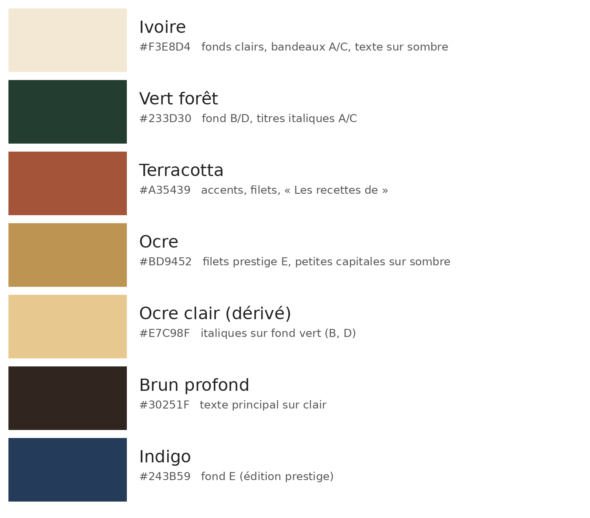

# Charte : palette et typographie

## Palette retenue et justification

| Couleur | Hex | Rôle | Pourquoi |
|---|---|---|---|
| Ivoire | `#F3E8D4` | Fonds clairs (A, C), texte sur fond sombre | Blanc chaud, « papier » : évite le fond blanc vide et s'accorde aux plats sans les dénaturer. |
| Vert forêt | `#233D30` | Fonds de B et D, italiques de A et C | Complémentaire des bruns, ocres et oranges des plats : la nourriture ressort **sans** saturation artificielle. C'est aussi la parade à la dominante orange des essais précédents. |
| Terracotta | `#A35439` | Accents, filets, « Les recettes de » | Terre cuite, canaris, poterie : présence culturelle discrète. À doser (jamais en aplat principal) pour ne pas recréer la dominante orange. |
| Ocre | `#BD9452` | Filets et petites capitales sur sombre (E) | Joue le rôle de l'or sans dorure clinquante ; adaptable en dorure à chaud réelle pour une édition reliée. |
| Ocre clair (dérivé) | `#E7C98F` | Italiques sur fond vert (B, D) | L'ocre `#BD9452` manque de contraste sur le vert forêt (environ 4,2:1). La version claire passe à environ 7:1. |
| Brun profond | `#30251F` | Texte principal sur clair | Remplace le noir pur : plus chaud, plus « livre ». |
| Indigo | `#243B59` | Fond de E | Renvoie aux teintures indigo d'Afrique de l'Ouest (adire, gara, bogolan foncé) sans aucun motif. Couleur classique de toile de reliure. |

Règle générale : **une couleur dominante par couverture**, une couleur d'accent au maximum, et les photos portent le reste.

## Typographie (deux familles au maximum par couverture)

| Concept | Titre | Texte secondaire |
|---|---|---|
| A, Portrait d'autrice | Cormorant Garamond 600 / italique 500 | Jost 500 (capitales espacées) |
| B, Transmission | Fraunces 300 / italique 300 (SOFT 50) | Jost 500 |
| C, Gastronomie | EB Garamond 500 / italique 400 | Manrope 600 |
| D, Afrique contemporaine | Instrument Serif / italique | Manrope 600 |
| E, Prestige | Bodoni Moda (famille unique) | — |

**Licences** : toutes ces polices sont publiées sous **SIL Open Font License 1.1** (Google Fonts). L'usage commercial, l'impression et l'incorporation dans un PDF ou un ebook sont autorisés, sans redevance. Seule la revente des fichiers de police eux-mêmes est interdite. Sources : https://fonts.google.com/specimen/Cormorant+Garamond, /Fraunces, /EB+Garamond, /Bodoni+Moda, /Instrument+Serif, /Jost, /Manrope (onglet « License » de chaque page). Les fichiers utilisés sont dans `04_sources/polices/`.

### Réglages appliqués
- Apostrophe typographique `’` (et non `'`), conformément à l'usage éditorial français. L'orthographe est inchangée : **L’Afrique dans mon assiette** / **Les recettes de Mme Fofana**.
- Crénage OpenType activé (`kern`, `liga`). Interlignage du titre resserré (0,82 à 0,95) pour former un bloc compact.
- En Bodoni (E), l'espace après l'apostrophe est réduit manuellement (−0,07 em) : le dessin de la police laisse sinon un trou entre L et A.
- Petites capitales espacées (+0,22 à +0,42 em) réservées à « Les recettes de », jamais au titre.
- Lignes de base de « dans mon assiette » et de « Mme Fofana » alignées dans A et B.
- Marges : texte à au moins 12,6 mm du bord de coupe (fond perdu de 3 mm + 9,6 mm), conforme aux zones de sécurité des imprimeurs (5 mm minimum).
