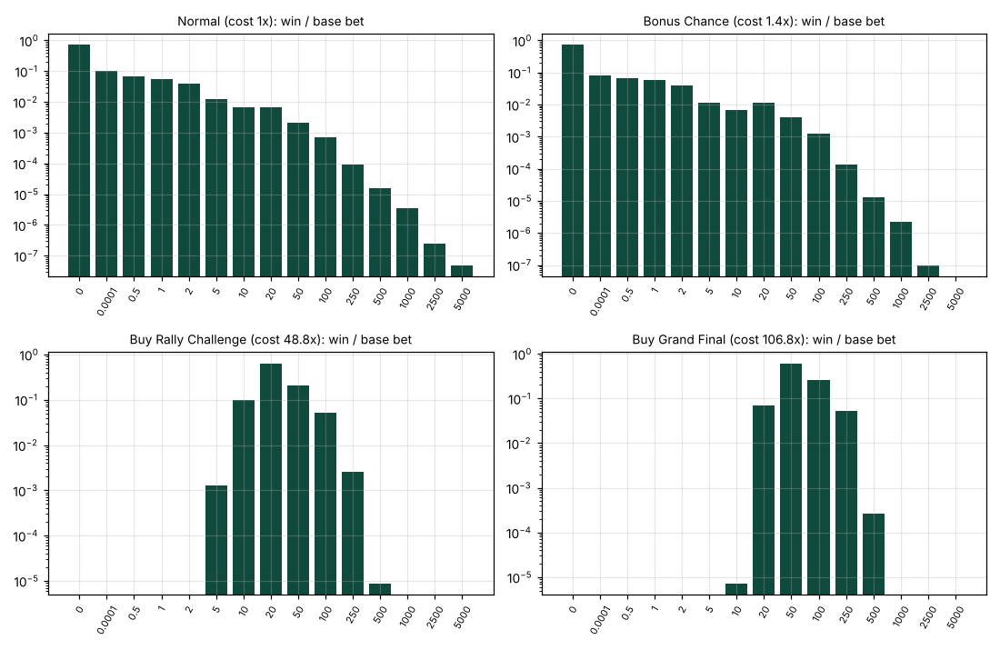
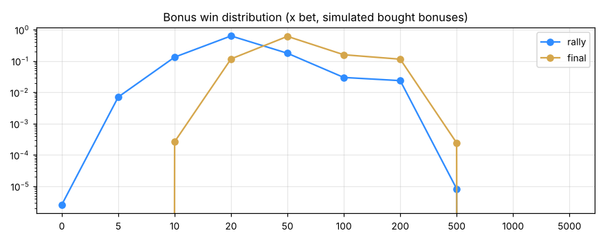

# Golden Rally — Match Point · Mathematical report (math v4.0.0)

_Generated by `python -m rally_math.report` from `math/reports/exact.json`, `math/reports/montecarlo.json`, `stake/publish_files/export_summary.json` and `stake/official_sdk_verification.json`. Do not edit by hand._

## 1. Method

- **Base game (exact).** Reels are independent and every stop is equiprobable; per-reel generating polynomials in (wilds, scatters) give the exact law of the base spin, its ways win and the trigger probabilities.

- **THE FINAL SET bonuses (simulated).** Court Control / Power Shots / marks / Hawk-Eye have state (marks, extensions) and are measured by targeted simulation of each trigger count (8 M Rally Challenges, 6 M Grand Finals with 4 scatters, 2 M with 5 and 6) with the vectorised engine, itself checked against the reference engine. The standard error of every RTP is reported.

- **Win cap (5 000×).** Measured by targeted simulation; with the v6 bonuses it is never reached in practice (see the cap effect row).

- **Monte-Carlo.** Independent numpy PCG64 streams (SeedSequence.spawn), 20 M rounds for the spin modes and ~1.9 M for each buy, used to check the exact values and to measure what has no closed form (hit rate, standard deviation, distribution, multiplier histogram).

- **Stake files.** Stratified look-up tables (no bonus / 3 / 4 / 5 / 6 scatters, payout bands up to the cap), each book replayed by the reference engine, then a minimal exponential tilt so that every stratum mean equals its exact (capped) mean.

## 2. Summary per bet mode

| | Normal | Bonus Chance | Buy Rally Challenge | Buy Grand Final |
|---|---|---|---|---|
| Cost (× base bet) | 1× | 1.4× | 48.8× | 106.8× |
| **RTP (calculated)** | **96.536 %** ± 0.008 | **96.550 %** ± 0.013 | **96.559 %** ± 0.029 | **96.460 %** ± 0.024 |
| Cap effect | −0.000 pt ± 0.000 | −0.000 pt ± 0.000 | −0.000 pt ± 0.000 | −0.000 pt ± 0.000 |
| RTP simulated (95 % CI) | 96.72 % [96.37 %; 97.08 %] | 96.76 % [96.46 %; 97.07 %] | 96.66 % [96.54 %; 96.78 %] | 96.39 % [96.31 %; 96.47 %] |
| Simulated rounds | 20 000 000 | 20 000 000 | 1 920 000 | 1 920 000 |
| RTP of the published table | 96.536 % | 96.550 % | 96.559 % | 96.460 % |
| Mean win (× base bet) | 0.965 | 1.352 | 47.121 | 103.019 |
| Hit frequency | 29.1 % | 27.9 % | 100.0 % | 100.0 % |
| Std dev (× base bet) | 8.2 | 9.8 | 40.6 | 63.5 |
| Std dev / cost | 8.16 | 6.97 | 0.83 | 0.59 |
| P(exactly 3 scatters) | 0.541 % | 1.242 % | 100 % (bought) | 0 |
| P(4+ scatters) | 0.0297 % | 0.1010 % | 0 | 100 % (bought) |
| Rally Challenge frequency | 1 / 184.7 | 1 / 80.5 | every round | never |
| Grand Final frequency | 1 / 3 371.1 | 1 / 990.2 | never | every round |
| Any bonus | 1 / 175.1 | 1 / 74.4 | every round | every round |
| Simulated bonus frequency | 1 / 174.2 | 1 / 74.4 | 1 / 1.0 | 1 / 1.0 |
| Max win reached (sim.) | 5 000× | 2 880× | 574× | 756× |

RTP shares of the Normal mode: ways 68.13 %, scatter pays 1.24 %, Rally Challenge 24.25 %, Grand Final 2.91 %. Bonus Chance: ways 47.52 %, scatter 2.18 %, Rally Challenge 39.74 %, Grand Final 7.10 %.

## 3. THE FINAL SET bonuses

Rules and design: [FINAL_SET_DESIGN.md](FINAL_SET_DESIGN.md). Values per trigger count (targeted simulation):

| Scatters | Bonus | Exchanges | E[bonus win] | Std error | Std dev | E[exchanges played] | Grand Slam / bonus | Hawk-Eye / bonus (IN share) | Marks set / hit / expired | Max observed |
|---|---|---|---|---|---|---|---|---|---|---|
| 3 | RALLY CHALLENGE | 8 | 44.79× | 0.014 | 40.5× | 8.80 | 4.91 % | — | 4.10 / 1.71 / 1.30 | 690× |
| 4 | THE GRAND FINAL | 12 | 97.78× | 0.026 | 63.6× | 13.95 | 12.61 % | 1.23 (60.0 %) | 8.70 / 4.00 / 2.52 | 852× |
| 5 | THE GRAND FINAL | 14 | 114.46× | 0.049 | 68.9× | 16.28 | 14.84 % | 1.43 (60.0 %) | 10.12 / 4.73 / 3.02 | 1 015× |
| 6 | THE GRAND FINAL | 16 | 131.22× | 0.052 | 74.0× | 18.60 | 17.11 % | 1.64 (60.0 %) | 11.54 / 5.47 / 3.52 | 1 029× |

Shot frequency per exchange (simulated; the tables are in config.FINAL_SET and are checked by a statistical test):

| Bonus | RALLY | ACE | SMASH | PASSING | DROP | GOLDEN |
|---|---|---|---|---|---|---|
| Rally Challenge | 47.0 % | 15.0 % | 12.0 % | 12.0 % | 8.0 % | 6.0 % |
| Grand Final (4 sc.) | 31.2 % | 17.2 % | 16.7 % | 16.7 % | 10.2 % | 8.0 % |

- rally: ceremony share — trophy (≥ 75×) 5.7 %, champion (≥ 200×) 2.36 %; championship points per bonus 0.00.
- final: ceremony share — trophy (≥ 75×) 42.8 %, champion (≥ 200×) 11.44 %; championship points per bonus 1.15.

Theoretical maximum: every exchange can add exchanges (Scatters  Hawk-Eye OUT) up to 30 remaining  so the rules allow wins up to the 5 000× cap; the cap ends the round when reached. Highest values observed in the simulations are in the table above.

## 4. Bonus buy prices

The price is not chosen in advance: it is the capped expectation of the bought round divided by the target RTP (96.5 %), rounded to 0.1× so that the RTP stays inside the 96.0–96.7 % window. One step of 0.1× moves the RTP by about 0.2 % for the Rally Challenge buy, so whole numbers could not stay inside the window.

| | Trigger spin E[win] | Bonus E[win] (uncapped) | Cap effect | E[round] | Fair price at 96.5 % | **Price** | RTP |
|---|---|---|---|---|---|---|---|
| Buy Rally Challenge (3 scatters, 8 exchanges) | 2.334× | 44.786× | −0.000× | 47.121× | 48.83× | **48.8×** | 96.559 % |
| Buy Grand Final (4 scatters, 12 exchanges) | 5.238× | 97.782× | −0.000× | 103.019× | 106.76× | **106.8×** | 96.460 % |

Each buy guarantees its bonus level (the bought spin always shows exactly 3, respectively 4, scatters, drawn with the exact conditional law of the normal reels), never an amount.

## 5. Bonus Chance

Same symbols, same pay table, same bonuses: only the number of scatters on the base reels differs. Probabilities never depend on the balance, the history or previous results. Options studied (exact, before cap, cost that would give 96.5 %):

| Scatters per reel (reels 1–6) | E[win] | Fair cost | Any bonus | Grand Final |
|---|---|---|---|---|
| Normal reels | 0.9654× | 1× | 1 / 175.1 | 1 / 3 371.1 |
| [2, 2, 1, 2, 2, 2] | 1.1955× | 1.239× | 1 / 96.6 | 1 / 1 449.7 |
| [2, 2, 2, 2, 2, 2] | 1.3517× | 1.401× | 1 / 74.4 | 1 / 990.2 |
| [2, 3, 2, 2, 2, 2] | 1.5059× | 1.560× | 1 / 60.7 | 1 / 754.5 |
| [2, 3, 2, 3, 2, 3] | 1.9002× | 1.969× | 1 / 41.7 | 1 / 449.7 |
| [3, 3, 3, 3, 3, 3] | 2.7381× | 2.837× | 1 / 25.4 | 1 / 220.1 |

**Chosen:** 2 scatters per reel, cost **1.4×**: bonus 1 / 74.4 instead of 1 / 175.1 (×2.35), Grand Final 1 / 990.2 instead of 1 / 3 371.1 (×3.40); RTP 96.550 % vs 96.536 % in Normal mode (difference +0.014 pt). No bonus is ever guaranteed.

## 6. Rules data

Pay per way (× total bet); a win = pay × number of ways (product of matching symbols per reel), from reel 1, 3 to 6 reels. 6 reels × 5 rows = 5⁶ = 15 625 ways (verified by enumeration in the tests).

| Symbol | Id | 3 | 4 | 5 | 6 |
|---|---|---|---|---|---|
| Ace, la mascotte | H1 | 0.5 | 1 | 2 | 5 |
| Trophée | H2 | 0.3 | 0.6 | 1.2 | 2.5 |
| Sac de tennis | H3 | 0.2 | 0.4 | 0.8 | 1.5 |
| Raquette | H4 | 0.2 | 0.3 | 0.6 | 1.2 |
| Balle de tennis | L1 | 0.1 | 0.2 | 0.3 | 0.4 |
| Chaussure | L2 | 0.1 | 0.1 | 0.2 | 0.3 |
| Casquette | L3 | 0.1 | 0.1 | 0.2 | 0.3 |
| Gourde | L4 | 0.1 | 0.1 | 0.2 | 0.3 |
| Poignet éponge | L5 | 0.1 | 0.1 | 0.2 | 0.2 |
| Scatter Stade (anywhere, not multiplied) | S | 2 | 5 | 20 | 100 |

The Wild (W) substitutes for every symbol except the Scatter; it is absent from reel 1.

Symbols per reel (reels 1–6). Paying symbols are stacked in blocks of 1/2/3 with probabilities (0.3, 0.4, 0.3).

| Symbol | Normal | Bonus Chance | Bonus reels (both bonuses) |
|---|---|---|---|
| W | [0, 0, 1, 1, 1, 1] | [0, 0, 1, 1, 1, 1] | [0, 1, 1, 1, 1, 1] |
| S | [1, 2, 1, 2, 1, 2] | [2, 2, 2, 2, 2, 2] | [1, 1, 1, 1, 1, 1] |
| H1 | [8, 8, 8, 8, 8, 8] | [8, 8, 8, 8, 8, 8] | [8, 8, 8, 8, 8, 8] |
| H2 | [9, 9, 9, 9, 9, 9] | [9, 9, 9, 9, 9, 9] | [9, 9, 9, 9, 9, 9] |
| H3 | [10, 10, 10, 10, 10, 10] | [10, 10, 10, 10, 10, 10] | [10, 10, 10, 10, 10, 10] |
| H4 | [11, 11, 11, 11, 11, 11] | [11, 11, 11, 11, 11, 11] | [11, 11, 11, 11, 11, 11] |
| L1 | [12, 12, 12, 12, 12, 12] | [12, 12, 12, 12, 12, 12] | [12, 12, 12, 12, 12, 12] |
| L2 | [12, 12, 12, 12, 12, 12] | [12, 12, 12, 12, 12, 12] | [12, 12, 12, 12, 12, 12] |
| L3 | [13, 13, 13, 13, 13, 13] | [13, 13, 13, 13, 13, 13] | [13, 13, 13, 13, 13, 13] |
| L4 | [13, 13, 13, 13, 13, 13] | [13, 13, 13, 13, 13, 13] | [13, 13, 13, 13, 13, 13] |
| L5 | [15, 15, 15, 16, 16, 16] | [15, 15, 15, 16, 16, 16] | [14, 14, 14, 14, 14, 14] |

## 7. Stake Engine files and official verification

| Mode | Cost | Books | Table RTP | Table std dev (×) | Max payout |
|---|---|---|---|---|---|
| `base` | 1 | 110 006 | 96.5358 % | 7.2 | 733× |
| `bonus_chance` | 1.4 | 110 019 | 96.5500 % | 10.2 | 960× |
| `buy_rally` | 48.8 | 6 007 | 96.5591 % | 40.2 | 614× |
| `buy_final` | 106.8 | 6 265 | 96.4601 % | 64.2 | 771× |

Official `engineio/math-sdk` verifier (commit `141b4e8`): submission issues: **0**; risk failures: base: 0, bonus_chance: 0, buy_rally: 0, buy_final: 0.

Limits checked by that tool (`utils/rgs_verification.py`): RTP 96.0–96.7 % per mode, one 1× base mode, cost ≤ 50 000×, max win ≤ 1 000 000×, base standard deviation ≥ 0.6. The Stake Engine approval guidelines web page could not be read from this environment (network), so mode-specific editorial rules (for example about bonus-chance style modes) remain to be confirmed.

