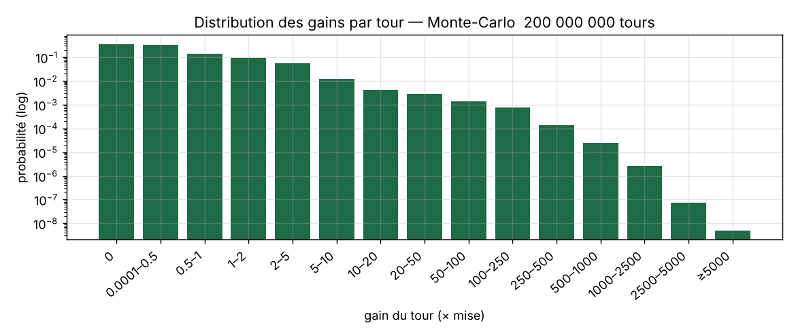
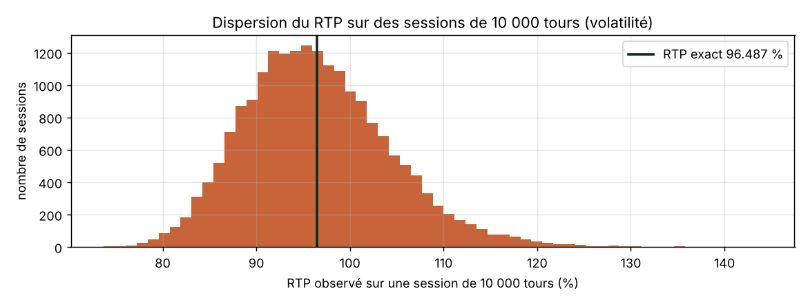

# Rapport mathématique — Golden Rally

Version math : **2.0.0** · généré automatiquement par `math/rally_math/report.py` à partir des sorties de calcul (aucun chiffre saisi à la main).

## 1. Modèle

- Grille **6 × 5**, **15 625 façons de gagner** : un symbole paie s'il apparaît (ou le Wild) sur des rouleaux adjacents depuis le rouleau 1, sur 3 à 6 rouleaux ; gain = valeur par façon × nombre de façons. Mise totale = 1.
- Bandes de rouleaux : `math/reels/BASE.csv` (jeu de base) et `math/reels/FREE.csv` (tours gratuits). Chaque position d'arrêt est équiprobable.
- Cycle complet du jeu de base : **1 365 618 945 600** grilles ; cycle des tours gratuits : **1 458 653 799 928** grilles.
- Wild (Smash) sur les rouleaux 2-6, remplace tout sauf le Scatter. Scatter (Trophée) paie partout ; 3/4/5/6 → 9/12/15/20 tours gratuits (Tie-Break).
- Multiplicateur « Rally » pendant les tours gratuits : ×1 → ×2 → ×3 → ×4 → ×5 → ×6 → ×8 → ×10 → ×12 → ×15 → ×20, indexé sur le nombre de Wilds tombés depuis le début du bonus ; appliqué aux gains en façons du tour où le Wild tombe. Relance : 3+ Scatters = +5 tours (50 restants max).
- Plafond de gain : **5 000× la mise** par tour.

### Table des gains (× mise totale, par façon gagnante)

| Symbole | 3 | 4 | 5 | 6 |
|---|---|---|---|---|
| Le Président (H1) | 0.5 | 1 | 2 | 5 |
| La Championne (H2) | 0.4 | 0.8 | 1.5 | 3 |
| L'Arbitre (H3) | 0.3 | 0.5 | 1.2 | 2.5 |
| Le Ramasseur (H4) | 0.2 | 0.4 | 1 | 2 |
| Le Bulldog (H5) | 0.2 | 0.3 | 0.8 | 1.5 |
| Avantage (L1) | 0.1 | 0.2 | 0.4 | 0.7 |
| Quarante (L2) | 0.1 | 0.2 | 0.3 | 0.6 |
| Trente (L3) | 0.1 | 0.1 | 0.3 | 0.5 |
| Quinze (L4) | 0.1 | 0.1 | 0.2 | 0.4 |
| Zéro (L5) | 0.1 | 0.1 | 0.2 | 0.4 |
| Trophée (S, n'importe où, total) | 2 | 5 | 20 | 100 |

## 2. Résultats exacts (polynômes générateurs par rouleau + chaîne de Markov)

Les rouleaux sont indépendants et chaque arrêt est équiprobable : l'espérance d'un gain en façons (produit de fonctions de chaque rouleau) est le produit des espérances par rouleau. Chaque rouleau fournit un polynôme en z (nombre de Wilds) et y (nombre de Trophées) ; leur produit donne exactement la loi jointe nécessaire au bonus. Méthode validée par énumération exhaustive sur des bandes réduites (test `test_polynomial_method_equals_brute_force_enumeration`).

| Indicateur | Valeur |
|---|---|
| **RTP théorique total** | **96.4871 %** |
| dont jeu de base (façons) | 60.916 % |
| dont Scatters du jeu de base | 1.255 % |
| dont tours gratuits | 34.316 % |
| Fréquence du bonus | 1 sur 173.6 (0.5762 %) |
| Gain moyen d'un bonus | 59.56× |
| Résidu numérique de la chaîne de Markov | 6.9e-12 |

| Déclenchement | Tours | Gain moyen du bonus | Tours joués (moy.) | P(atteindre ×20) | Multiplicateur final moyen |
|---|---|---|---|---|---|
| 3 Trophées (p = 5.462e-03) | 9 | 57.27× | 9.08 | 5.2 % | ×9.41 |
| 4 Trophées (p = 2.921e-04) | 12 | 99.68× | 12.11 | 24.6 % | ×13.54 |
| 5 Trophées (p = 8.110e-06) | 15 | 152.48× | 15.14 | 53.7 % | ×16.81 |
| 6 Trophées (p = 9.153e-08) | 20 | 252.25× | 20.19 | 87.8 % | ×19.35 |

Le calcul exact donne la moyenne (RTP) sans le plafond de 5 000× ; l'écart-type, la fréquence de gain et l'effet du plafond viennent de la simulation ci-dessous (plafond atteint environ 1 fois sur 200 millions de tours : effet sur le RTP inférieur à 10⁻⁵).

## 3. Contrôle Monte-Carlo (moteur de référence, tours indépendants)

Générateur : numpy PCG64, SeedSequence.spawn per worker, graine 20261115.

| Indicateur | Simulé | Exact |
|---|---|---|
| Tours simulés | 200 000 000 | — |
| RTP | 96.468 % ± 0.108 % (IC 95 %) | 96.487 % |
| Écart normalisé z | -0.36 | (|z| < 2 attendu) |
| Fréquence de gain (tout gain > 0) | 64.69 % | — |
| Bonus 1 sur | 173.7 | 173.6 |
| Écart-type par tour | 7.772× | — |
| RTP base / bonus | 62.179 % / 34.291 % | 62.171 % / 34.316 % |
| Tours gratuits joués par bonus | 9.25 | — |
| Bonus terminés au multiplicateur maximal | 11.1 % | — |
| Tours plafonnés à 5 000× | 1 | — |
| Plus gros gain observé | 5000.0× | plafond 5 000× |

Note : beaucoup de « gains » sont inférieurs à la mise (typique des jeux à façons). Le jeu ne les célèbre pas (pas de son de victoire ni d'animation festive).

Sur une session de 10 000 tours, le RTP observé a un écart-type d'environ **7.8 points** : un joueur ou un opérateur peut s'écarter largement de 96,49 % à court terme. C'est la conséquence normale de la volatilité, pas une anomalie.

## 4. Fichiers Stake Engine (table de correspondance publiée)

- 112 662 tours enregistrés (« books »), pondérés par strates aux probabilités exactes (pas de bonus ; bonus à 3, 4, 5, 6 Trophées), avec des tranches de gros gains (≥ 500×, ≥ 2 000×, ≥ 4 000×) estimées par un pilote Monte-Carlo, pour que les gains rares jusqu'au plafond existent réellement dans la table. Calibration finale par basculement exponentiel minimal dans chaque strate. Chaque book est reconstruit par le moteur de référence et vérifié.
- **RTP de la table publiée : 96.48713 %** (écart au modèle exact : 1.3e-11).
- Écart-type : 7.772× · fréquence de gain : 64.96 % · gain maximal présent dans la table : **5000.0×**.

| Strate | Probabilité | Books | Moyenne visée | Moyenne échantillon | Divergence KL | Gain max |
|---|---|---|---|---|---|---|
| no_bonus | 9.9424e-01 | 100000 | 0.6107× | 0.6118× | 2.2e-07 | 125.2× |
| bonus_3_trophies | 5.4616e-03 | 8380 | 59.6119× | 59.4632× | 1.9e-06 | 5000.0× |
| bonus_4_trophies | 2.9206e-04 | 2810 | 104.9596× | 104.0742× | 3.1e-05 | 5000.0× |
| bonus_5_trophies | 8.1099e-06 | 992 | 172.7006× | 171.3802× | 4.3e-05 | 5000.0× |
| bonus_6_trophies | 9.1534e-08 | 480 | 352.4251× | 358.9480× | 5.7e-04 | 5000.0× |

Empreintes SHA-256 : books `dbeedfa56188cf0a…`, table `38243c0e0d451d91…`.

Sur Stake Engine, le serveur ne tire que des tours présents dans les books : le gain maximal réellement atteignable est donc celui de la table, **5000×**, égal au plafond affiché.

## 5. Vérification par l'outil officiel (engineio/math-sdk)

- Commit du SDK : `141b4e89065ac4400769709a919259a923430c4d`
- Format de la table et des books : conforme ; paiements books = table : conforme.
- Problèmes bloquant la soumission : **0** · contrôles de risque en échec : **0**.
- RTP mesuré par l'outil : 96.49 % (limites de soumission du SDK : 96,0 %–96,7 %) · écart-type : 7.77.

Cette vérification automatique n'est **pas** une approbation : l'approbation relève de Stake Engine et, selon les marchés, d'un laboratoire de certification.

## 6. Indépendance des tours

Le résultat d'un tour est une fonction pure des positions d'arrêt tirées pour ce tour. Aucun paramètre ne dépend du solde, de l'historique, des gains précédents ou du comportement du joueur. Les tests `test_determinism_and_replay` et `test_independence_of_rounds_order` le vérifient ; sur Stake Engine, chaque tour est un tirage indépendant dans la table publiée.
