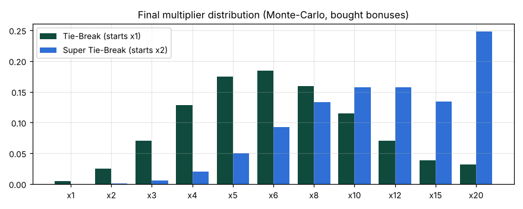

# Golden Rally — Match Point · Mathematical report (math v3.0.0)

_Generated by `python -m rally_math.report` from `math/reports/exact.json`, `math/reports/montecarlo.json`, `stake/publish_files/export_summary.json` and `stake/official_sdk_verification.json`. Do not edit by hand._

## 1. Method

- **Exact part.** Reels are independent and every stop is equiprobable. Each reel contributes a generating polynomial in (wilds, scatters); their product gives the exact law of the base spin and of every free spin. Both bonuses are one absorbing Markov chain on (spins remaining ≤ 50, ladder position); the Super Tie-Break simply starts one ladder step higher. Markov residual: 7.6e-12.

- **Win cap (5 000×).** The cap is the only term that is not closed-form. For each scatter count k the overshoot E[(win − cap)⁺ | k] is measured by a targeted simulation of 2,000,000 triggered rounds and subtracted. All RTPs below are **after the cap**, with its standard error shown.

- **Monte-Carlo.** Independent numpy PCG64 streams (SeedSequence.spawn), 20 M rounds for the spin modes and ~1.9 M for each buy, used to check the exact values and to measure what has no closed form (hit rate, standard deviation, distribution, multiplier histogram).

- **Stake files.** Stratified look-up tables (no bonus / 3 / 4 / 5 / 6 scatters, payout bands up to the cap), each book replayed by the reference engine, then a minimal exponential tilt so that every stratum mean equals its exact (capped) mean.

## 2. Summary per bet mode

| | Normal | Bonus Chance | Buy Tie-Break | Buy Super Tie-Break |
|---|---|---|---|---|
| Cost (× base bet) | 1× | 1.4× | 49.4× | 105× |
| **RTP (exact, after cap)** | **96.524 %** | **96.513 %** | **96.522 %** | **96.406 %** |
| RTP without cap (exact) | 96.671 % | 96.758 % | 96.957 % | 97.381 % |
| Cap effect | −0.147 pt ± 0.014 | −0.245 pt ± 0.023 | −0.435 pt ± 0.050 | −0.974 pt ± 0.063 |
| RTP simulated (95 % CI) | 96.43 % [95.88 %; 96.98 %] | 96.74 % [96.18 %; 97.29 %] | 96.73 % [96.37 %; 97.09 %] | 96.47 % [96.19 %; 96.76 %] |
| Simulated rounds | 20 000 000 | 20 000 000 | 1 920 000 | 1 920 000 |
| RTP of the published table | 96.524 % | 96.513 % | 96.522 % | 96.406 % |
| Mean win (× base bet) | 0.965 | 1.351 | 47.682 | 101.226 |
| Hit frequency | 27.9 % | 27.8 % | 100.0 % | 100.0 % |
| Std dev (× base bet) | 12.5 | 17.6 | 125.6 | 211.3 |
| Std dev / cost | 12.51 | 12.59 | 2.54 | 2.01 |
| P(exactly 3 scatters) | 0.541 % | 1.242 % | 100 % (bought) | 0 |
| P(4+ scatters) | 0.0297 % | 0.1010 % | 0 | 100 % (bought) |
| Tie-Break frequency | 1 / 184.7 | 1 / 80.5 | every round | never |
| Super Tie-Break frequency | 1 / 3 371.1 | 1 / 990.2 | never | every round |
| Any bonus | 1 / 175.1 | 1 / 74.4 | every round | every round |
| Simulated bonus frequency | 1 / 174.6 | 1 / 74.5 | 1 / 1.0 | 1 / 1.0 |
| Max win reached (sim.) | 5 000× | 5 000× | 5 000× | 5 000× |

RTP shares of the Normal mode: ways 67.86 %, scatter pays 1.24 %, Tie-Break 24.65 %, Super Tie-Break 2.92 % (before cap). Bonus Chance: ways 47.03 %, scatter 2.18 %, Tie-Break 40.40 %, Super 7.15 %.

## 3. Bonuses

| Scatters on the trigger spin | Bonus | Free spins | Start multiplier | E[bonus win] (uncapped) | E[spins played] | E[retriggers] | E[final multiplier] | P(reach ×20) | Cap overshoot (sim.) |
|---|---|---|---|---|---|---|---|---|---|
| 3 | TIE-BREAK | 9 | ×1 | 45.53× | 9.09 | 0.018 | ×7.22 | 3.1 % | 0.215× ± 0.025 |
| 4 | SUPER TIE-BREAK | 12 | ×2 | 97.04× | 12.12 | 0.023 | ×12.41 | 24.8 % | 1.023× ± 0.066 |
| 5 | SUPER TIE-BREAK | 15 | ×2 | 145.83× | 15.15 | 0.029 | ×15.53 | 49.5 % | 1.744× ± 0.085 |
| 6 | SUPER TIE-BREAK | 20 | ×2 | 241.36× | 20.20 | 0.039 | ×18.64 | 82.2 % | 4.126× ± 0.135 |

A scatter can show at most once per reel (strip constraint, tested), so 3, 4, 5 and 6 are the only trigger counts. 4, 5 and 6 scatters all give the Super Tie-Break; 5 and 6 add spins (15 / 20) and bigger scatter pays. During either bonus, 3+ scatters add 5 spins (at most 50 remaining). The Super Tie-Break has better starting conditions (12 spins and ×2 instead of 9 spins and ×1); it does **not** guarantee a bigger win in every round.

Final multiplier distribution (simulated over the bought bonuses):

| Multiplier | ×1 | ×2 | ×3 | ×4 | ×5 | ×6 | ×8 | ×10 | ×12 | ×15 | ×20 |
|---|---|---|---|---|---|---|---|---|---|---|---|
| Tie-Break | 0.4 % | 2.5 % | 7.0 % | 12.9 % | 17.4 % | 18.4 % | 15.9 % | 11.4 % | 7.1 % | 3.8 % | 3.1 % |
| Super Tie-Break | 0.0 % | 0.1 % | 0.5 % | 2.0 % | 5.0 % | 9.3 % | 13.3 % | 15.8 % | 15.7 % | 13.4 % | 24.8 % |

## 4. Bonus buy prices

The price is not chosen in advance: it is the capped expectation of the bought round divided by the target RTP (96.5 %), rounded to 0.1× so that the RTP stays inside the 96.0–96.7 % window. A whole number was not possible for the Tie-Break (one step of 1× moves the RTP by ~2 %, more than the window).

| | Trigger spin E[win] | Bonus E[win] (uncapped) | Cap effect | E[round] | Fair price at 96.5 % | **Price** | RTP |
|---|---|---|---|---|---|---|---|
| Buy Tie-Break (3 scatters, 9 spins, ×1) | 2.371× | 45.525× | −0.215× | 47.682× | 49.41× | **49.4×** | 96.522 % |
| Buy Super Tie-Break (4 scatters, 12 spins, ×2) | 5.211× | 97.039× | −1.023× | 101.226× | 104.90× | **105×** | 96.406 % |

Each buy guarantees its bonus level (the bought spin always shows exactly 3, respectively 4, scatters, drawn with the exact conditional law of the normal reels), never an amount.

## 5. Bonus Chance

Same symbols, same pay table, same bonuses: only the number of scatters on the base reels differs. Probabilities never depend on the balance, the history or previous results. Options studied (exact, before cap, cost that would give 96.5 %):

| Scatters per reel (reels 1–6) | E[win] | Fair cost | Any bonus | Super Tie-Break |
|---|---|---|---|---|
| Normal reels | 0.9652× | 1× | 1 / 175.1 | 1 / 3 371.1 |
| [2, 2, 1, 2, 2, 2] | 1.1960× | 1.239× | 1 / 96.6 | 1 / 1 449.7 |
| [2, 2, 2, 2, 2, 2] | 1.3546× | 1.404× | 1 / 74.4 | 1 / 990.2 |
| [2, 3, 2, 2, 2, 2] | 1.5112× | 1.566× | 1 / 60.7 | 1 / 754.5 |
| [2, 3, 2, 3, 2, 3] | 1.9136× | 1.983× | 1 / 41.7 | 1 / 449.7 |
| [3, 3, 3, 3, 3, 3] | 2.7707× | 2.871× | 1 / 25.4 | 1 / 220.1 |

**Chosen:** 2 scatters per reel, cost **1.4×**: bonus 1 / 74.4 instead of 1 / 175.1 (×2.35), Super Tie-Break 1 / 990.2 instead of 1 / 3 371.1 (×3.40); RTP 96.513 % vs 96.524 % in Normal mode (difference -0.011 pt). No bonus is ever guaranteed.

## 6. Rules data

Pay per way (× total bet); a win = pay × number of ways (product of matching symbols per reel), from reel 1, 3 to 6 reels. 6 reels × 5 rows = 5⁶ = 15 625 ways (verified by enumeration in the tests).

| Symbol | Id | 3 | 4 | 5 | 6 |
|---|---|---|---|---|---|
| Ace, la mascotte | H1 | 0.5 | 1 | 2 | 5 |
| Trophée | H2 | 0.3 | 0.6 | 1.2 | 2.5 |
| Sac de tennis | H3 | 0.2 | 0.4 | 0.8 | 1.5 |
| Raquette | H4 | 0.2 | 0.3 | 0.6 | 1.2 |
| Balle de tennis | L1 | 0.1 | 0.2 | 0.3 | 0.4 |
| Chaussure | L2 | 0.1 | 0.1 | 0.2 | 0.3 |
| Casquette | L3 | 0.1 | 0.1 | 0.2 | 0.3 |
| Gourde | L4 | 0.1 | 0.1 | 0.2 | 0.3 |
| Poignet éponge | L5 | 0.1 | 0.1 | 0.2 | 0.2 |
| Scatter Stade (anywhere, not multiplied) | S | 2 | 5 | 20 | 100 |

The Wild (W) substitutes for every symbol except the Scatter; it is absent from reel 1. Multiplier ladder: ×1 → ×2 → ×3 → ×4 → ×5 → ×6 → ×8 → ×10 → ×12 → ×15 → ×20.

Symbols per reel (reels 1–6). Paying symbols are stacked in blocks of 1/2/3 with probabilities (0.3, 0.4, 0.3).

| Symbol | Normal | Bonus Chance | Bonus (both levels) |
|---|---|---|---|
| W | [0, 0, 1, 1, 1, 1] | [0, 0, 1, 1, 1, 1] | [0, 2, 3, 3, 2, 2] |
| S | [1, 2, 1, 2, 1, 2] | [2, 2, 2, 2, 2, 2] | [1, 1, 1, 1, 1, 1] |
| H1 | [8, 8, 8, 8, 8, 8] | [8, 8, 8, 8, 8, 8] | [8, 8, 8, 8, 8, 8] |
| H2 | [9, 9, 9, 9, 9, 9] | [9, 9, 9, 9, 9, 9] | [9, 9, 9, 9, 9, 9] |
| H3 | [10, 10, 10, 10, 10, 10] | [10, 10, 10, 10, 10, 10] | [10, 10, 10, 10, 10, 10] |
| H4 | [11, 11, 11, 11, 11, 11] | [11, 11, 11, 11, 11, 11] | [11, 11, 11, 11, 11, 11] |
| L1 | [12, 12, 12, 12, 12, 12] | [12, 12, 12, 12, 12, 12] | [12, 12, 12, 12, 12, 12] |
| L2 | [12, 12, 12, 12, 12, 12] | [12, 12, 12, 12, 12, 12] | [12, 12, 12, 12, 12, 12] |
| L3 | [13, 13, 13, 13, 13, 13] | [13, 13, 13, 13, 13, 13] | [13, 13, 13, 13, 13, 13] |
| L4 | [13, 13, 13, 13, 13, 13] | [13, 13, 13, 13, 13, 13] | [13, 13, 13, 13, 13, 13] |
| L5 | [15, 15, 15, 16, 16, 16] | [15, 15, 15, 16, 16, 16] | [14, 14, 14, 14, 14, 14] |

## 7. Stake Engine files and official verification

| Mode | Cost | Books | Table RTP | Table std dev (×) | Max payout |
|---|---|---|---|---|---|
| `base` | 1 | 110 800 | 96.5237 % | 11.6 | 5 000× |
| `bonus_chance` | 1.4 | 110 800 | 96.5128 % | 18.0 | 5 000× |
| `buy_tiebreak` | 49.4 | 6 760 | 96.5218 % | 122.3 | 5 000× |
| `buy_super` | 105 | 6 760 | 96.4061 % | 201.4 | 5 000× |

Official `engineio/math-sdk` verifier (commit `141b4e8`): submission issues: **0**; risk failures: base: 0, bonus_chance: 0, buy_tiebreak: 0, buy_super: 0.

Limits checked by that tool (`utils/rgs_verification.py`): RTP 96.0–96.7 % per mode, one 1× base mode, cost ≤ 50 000×, max win ≤ 1 000 000×, base standard deviation ≥ 0.6. The Stake Engine approval guidelines web page could not be read from this environment (network), so mode-specific editorial rules (for example about bonus-chance style modes) remain to be confirmed.

