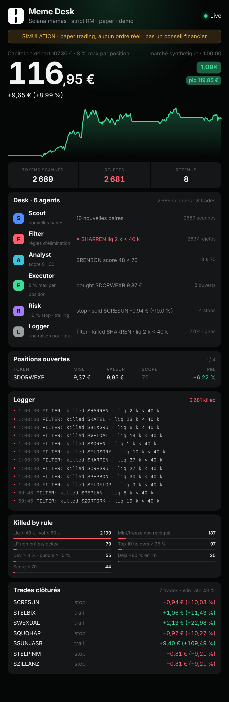

# Meme Desk

Scanner de memecoins Solana avec **paper trading** (trading fictif) et tableau de bord en direct.

> ⚠️ **Simulation uniquement.** Aucun ordre réel n'est envoyé, aucun wallet n'est connecté, aucune clé privée n'est demandée. Ce n'est pas un conseil financier.
> Les memecoins sont extrêmement risqués : rugs, honeypots, bots MEV, slippage. La plupart des tokens tombent à zéro.



## Démarrer

Il faut Python 3.10 ou plus récent. Aucune dépendance à installer.

```bash
cd meme-desk
python -m desk --demo            # marché synthétique, 1 h simulée en ~4 min
python -m desk --live            # vraies données DexScreener + RPC Solana, trades fictifs
```

Ouvre ensuite http://127.0.0.1:8000.

Options utiles :

| Option | Effet |
|---|---|
| `--seed 7` | rend la démo reproductible |
| `--speed 20` | accélère la démo (ticks de 15 s par seconde réelle, `0` = max) |
| `--duration-min 120` | durée simulée de la démo |
| `--config config.example.json` | change les règles (voir `desk/config.py`) |
| `--no-server --state-out state.json` | exécution sans interface, résumé et état JSON à la fin |

Lancer les tests : `python -m unittest -v`

## Les 6 agents

| Agent | Rôle |
|---|---|
| **Scout** | récupère les nouveaux tokens Solana (DexScreener : derniers profils et boosts) |
| **Filter** | applique les règles d'élimination ci-dessous ; les données de marché sont vérifiées d'abord, le RPC n'est appelé que si elles passent |
| **Analyst** | note de 0 à 100 (liquidité, volume/liquidité, part d'acheteurs, distribution, momentum, âge, réseaux sociaux) ; seuil 70 |
| **Executor** | achat fictif, au plus 8 % de l'equity, 4 positions maximum, frais et impact de prix inclus |
| **Risk** | stop −6 %, trailing stop (armé à +30 %, sortie à −15 % du plus haut), sortie au bout de 45 min, détection de rug |
| **Logger** | une raison écrite pour chaque rejet, achat et vente |

### Règles d'élimination (strict RM)

- Liquidité < 40 k$ ou volume 1 h < 50 k$
- Mint authority ou freeze authority non révoquée
- LP non brûlée ou non lockée
- Top 10 des holders > 25 % de l'offre (le plus gros compte est exclu, car c'est en général la pool)
- Dev > 3 % ou lancement « bundled » > 10 %
- Déjà +80 % en 1 h (trop tard)

Avec `reject_unknown: true` (valeur par défaut), une donnée on-chain qu'on n'a pas pu vérifier **entraîne le rejet**.

## Limites du mode live (à lire)

- **LP** : seules les paires PumpSwap et pump.fun sont considérées comme brûlées, car pump.fun brûle la LP à la migration. Sur Raydium, la LP n'est pas vérifiée, donc ces paires sont rejetées en mode strict.
- **Dev et bundle** : ces données ne sont pas disponibles gratuitement et ne sont donc pas contrôlées en live. Elles ne servent que dans la démo.
- **Top 10** : c'est une approximation par `getTokenLargestAccounts`. Si plusieurs comptes appartiennent à des pools ou des programmes, le chiffre est faussé.
- Le **RPC public** de Solana est limité en débit. Pour un usage régulier, mets un RPC dédié dans `rpc_url`.
- Le paper trading **surestime** les résultats : pas de transactions qui échouent, pas de MEV, pas de honeypot (token qu'on ne peut pas revendre), prix relevés toutes les 10 s seulement.

## Pourquoi tes résultats ne ressembleront pas aux vidéos TikTok

Une vidéo qui montre ×8,5 en une heure avec une courbe presque toujours montante est, au mieux, une simulation avantageuse. Au pire, c'est une animation faite pour vendre un « script ». Dans ce projet, un stop à −6 % sort souvent vers −9/−10 % à cause des frais, du slippage et des trous de prix. Et le marché démo est volontairement rempli de rugs.

Le mode démo n'a aucune valeur prédictive : son marché est inventé.
